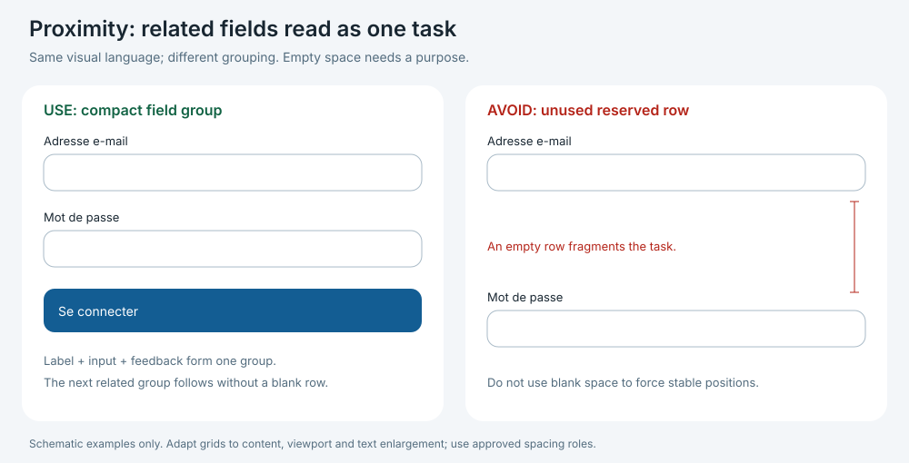

# Approved application design guide

Status: owner-approved, 2026-10-29, following explicit approval to turn the discussed design principles into a guide used across the application and read before every implementation. This guide governs new and changed UI. It does not claim every existing screen already conforms or authorize implementing another ticket.

## Start here — every implementation

1. Read this guide at the start of each authorized ticket or explicit scope. Reuse the read within unchanged scope. For non-UI work, record `Design applicability: no interface impact` once; stop the visual workflow here.
2. For UI work, read [token roles](designtokens.md), the actual affected components and the current behavior contract. Identify the page pattern below, primary task, shared components, token roles and content/permission states. A few lines in the existing implementation report suffice.
3. Build using shared components and the rules below. Compare against the approved component specimens and, when available, a relevant accepted application capture. For a new page/pattern without a capture, use the specimens plus this guide's composition rules; no prior capture approval is required. A previously accepted capture is evidence of a particular composition, not authority to reproduce defects or obsolete behavior.
4. Inspect rendered desktop/mobile and relevant state captures. Run the focused checks below. Have the existing independent reviewer assess visual composition alongside standards/specification. Record actual results, limitations and exceptions in the existing report.

Completion: applicable rules, screenshots/state evidence and exception disposition are accounted for. Passing typecheck or a screenshot capture alone does not establish visual acceptance. No additional review worker or owner approval round is introduced for routine layout choices within these rules.

## Authority and scope

- Spec001, approved amendments and the current ticket govern behavior, data, permissions and destinations. This guide governs appearance and composition; specimens never add product requirements.
- Approved appearance source: `D:/clinic-visual-system/tokens.json` (Clinic Visual Language1.0.0), with its `index.html` and `screenshots/` as component specimens. In-repository token snapshot/export: [JSON](../apps/web/src/workspace/tokens.json), [CSS](../apps/web/src/workspace/tokens.css). This guide adds application composition rules; the external package has no application page layouts.
- Blue is default; teal uses the same semantic roles and visual hierarchy. Owner direction for borderless content and appointment cards supersedes the specimen's default card border. Control, focus, invalid-state and necessary row-divider affordances remain.
- Previous prototype documents, HTML and images in this directory are historical visual material. Their branding, geometry, widgets, language controls and sample data are retired as implementation instructions. Earlier document versions remain in Git history. Never copy the specimen guide's documentation layout or import its visual-guide.css into the application.

## Foundations — stable roles, responsive geometry

| Area | Required rule |
| --- | --- |
| Color | Use semantic canvas/surface/text/primary/selected/status roles from the token export. Keep on-primary/on-accent paired with their backgrounds. Status is also expressed in words or icons. No per-page palette, arbitrary brand hex or new dark mode. |
| Type | Inter for UI. Body14px/1.5, secondary metadata12–13px, section headings20px/1.25, page titles30px/1.25; title28px may serve constrained layouts. Use token weights400/500/600 for body/labels/headings. Instrument Serif is optional editorial emphasis, not the default for operational headings or data. Meaningful normal text must not shrink to fit. |
| Shape | Token radii: controls12px, content cards20px, emphasized surfaces28px, badges pill. Outline icons use a consistent approximately20px size and stroke treatment. Content surfaces are borderless; shadows are absent/subtle, with floating shadows reserved for overlays. |
| Controls | Default control height40px, large48px. Allow growth for wrapping/text enlargement; provide at least44px activation targets for touch controls. Native buttons/inputs/selects are appropriate when their behavior suffices. |
| Rhythm | Use the approved spacing scale and the role table below. Internal gaps are smaller than separation between groups. Avoid multiple competing margins/gaps on the same boundary. |
| Numbers | Align comparable amounts and table columns, use tabular numerals where useful, keep currency/units explicit and preserve exact server amounts. Distinguish debt, credit and future care. Layout never invents data or changes financial meaning. |

The golden ratio is an optional exploratory proportion, not a mandatory acceptance test. Readability, task hierarchy, content fit and responsive behavior determine the actual grid.

## Proximity and spacing roles

These are approved defaults for changed compositions, mapped to existing tokens. Role names describe intended use; they are not claims that CSS aliases/shared components already exist. Reuse the underlying variable or introduce a shared role alias when a real repeated use warrants it.

| Role | Default token | Relationship |
| --- | --- | --- |
| Label → its control | space.8 | The label reads with its field, not with its neighbor. |
| Control → help/error | space.4 or space.8 | Keep feedback attached to its control; allow it to wrap. |
| Field group → next field group | space.16 | Measure between complete label/control/help groups, not only input boxes. |
| Related row actions | space.8 | Related controls form one action group. |
| Title → explanation | space.8 or space.12 | Keep the heading and its explanation together. |
| Section heading → content | space.16 or space.20 | Stronger separation than label/control spacing. |
| Panel interior | space.24 desktop; space.16 or space.20 narrow | Maintain consistent insets within a composition. |
| Independent sections | space.32; space.24 in compact compositions | Separate tasks without fragmenting related information. |
| Page gutters | space.32 or space.40 desktop; space.24 tablet; space.16 mobile | Align title, toolbar and content to the same content edge. |

Use one documented density per page pattern; do not alternate compact/spacious panels arbitrarily. Defaults may adapt to content through the exception rule below. Different semantic roles may share a token.

**Login lesson:** do not reserve an empty field row to hold the password still. Place clinic code/username side by side when they fit, with email spanning that row. Preserve shared control positions during ordinary tab switching. At constrained widths or enlarged text, readable wrapping/stacking and accessible scrolling take priority over fixed geometry. No fixed height may clip errors, translations or input.

The diagram illustrates grouping, not a required page layout or a pixel-exact form specification.

## Composition and page patterns

- **Alignment:** establish one content edge for title, explanation, toolbar and primary content. Columns and rows align through CSS grid/flex; avoid manual offsets and spacers. Keep labels consistently above controls and comparable row content on common baselines.
- **Hierarchy:** one h1 per page, ordered section headings and one dominant action per task region. Secondary/cancel actions remain visually quieter; destructive actions have explicit meaning and confirmation where required by the behavior contract. Do not turn every element into a card or primary button.
- **Width:** dense operational pages use the shared workspace content width (current shell maximum1500px); the outer gutter applies inside it. Reading/forms use a narrower measure, normally 40–65 characters for prose and roughly420–640px for a focused form, capped by available width. These are layout defaults, not dimensions from the external specimens. Full-page data tables may use more width.
- **Balance:** give the primary task more space than secondary context. Place helpful information near the decision it supports. Avoid decorative panels/charts/metrics with no authorized purpose. Empty states occupy a content region honestly; they do not become fabricated dashboard data.

| Pattern | Repeated composition |
| --- | --- |
| Operational dashboard | Page heading/date scope → authorized daily work → supporting financial/follow-up/stock regions. Show only permitted, implemented capabilities; preserve honest empty/unavailable states. |
| Searchable list | Heading + authorized primary action → search/filters → results → pagination when implemented. Keep row structure consistent; distinguish no records, no matches, loading and denied states. |
| Patient profile | Patient identity/context → implemented section navigation → active section content/actions. Preserve permission boundaries; route/page ownership comes from the ticket. |
| Form | Title/explanation → related field groups → feedback → primary/secondary actions. Optional or dependent fields sit with their parent task. Use columns only while labels, errors and controls fit. |
| Dialog | Named title/context → focused content → action group. Use Radix for compound interaction, bounded width, viewport-safe scrolling and focus restoration. Financial/clinical confirmations follow the approved contract. |
| Details/report | Scope/date/identity context → key result → supporting rows/details → authorized output actions. Keep units, currency, cutoff and unavailable states visible. |

Patterns define relationships, not new features. Omit unfinished destinations and unapproved actions. Reuse a shared composition when a real second use appears; do not scaffold an entire component library in advance.

## Components, interaction and responsive rules

- Reuse the existing styled component for the same function. Keep variants explicit and few: primary/secondary/destructive actions, field with label/help/error, section surface, badge and state feedback. Put repeated spacing/state styling in the shared composition rather than duplicating CSS per page.
- Radix Primitives handles applicable compound keyboard/focus/ARIA mechanics (tabs, dialogs, menus, popovers); application CSS supplies the appearance. Do not replace adequate native HTML merely to use Radix. Query/RHF/Zustand boundaries and server authorization remain unchanged.
- Responsive order follows reading/task priority. Collapse columns when content stops fitting; never rely solely on a breakpoint name. Use logical layout properties. At320px, avoid page-level horizontal scrolling; dense tables may use a labeled local horizontal-scroll region while identity/actions remain usable.
- Normal desktop login fits the viewport without unnecessary scrolling; smaller heights, errors and text enlargement may scroll to keep all controls accessible. Keep content-driven heights and wrapping; hide secondary decoration before compromising the task.
- Give every control a meaningful French label, visible focus and applicable hover/selected/disabled/invalid states. Meet contrast4.5:1 for normal text and3:1 for large text/essential UI boundaries. Test actual color pairings in both palettes when a shared style changes. Respect reduced motion.
- Keyboard order follows visual order. Test opening/closing, Escape where supported, tab/arrow behavior and returned focus for the actual Radix composition. A primitive alone does not certify the completed screen's accessibility.

## Delivery and independent review

For changed UI, the existing report must cover:

- [ ] Applicable pattern, shared components, token/spacing roles and any exceptions identified before edits.
- [ ] Rendered affected states: normal, loading, empty/no matches, denied and relevant validation/error/conflict/uncertain states. Record inapplicable states rather than inventing them.
- [ ] Desktop and narrow captures; check320/768/1024/1440px widths and relevant short desktop height. Verify text enlargement to200%, wrapping and reachable controls. Capture representative states; do not create a redundant screenshot matrix for every combination.
- [ ] Both blue/teal when a shared visual rule changes; keyboard/focus and actual text/background contrast checks. Record browser, viewport, checked revision, evidence paths and omissions.
- [ ] Visual inspection: related elements grouped, shared edges aligned, primary task obvious, no accidental gaps/overlap/clipping or unexplained layout jumps. Compare component appearance with specimens; no page-level match to nonexistent reference screens.
- [ ] Meaningful regression at the existing approved browser seam when behavior or a recurring visual defect warrants it. Retain the current test suite; do not test every spacing constant or claim that passing tests establishes good composition.

The same independent Standards/Spec reviewer checks these items with proportional evidence. Existing owner preview requirements remain; no automatic merge, next ticket or new approval gate follows from this guide.

## Exceptions and adoption

For a local exception, record the rule, affected component/page, content/accessibility reason, chosen token/behavior and rendered evidence. Routine responsive/content-fit adjustments within this guide use agent judgment. A change to visual identity, settled product behavior or an unresolved authoritative contradiction needs the owner's decision for the affected part only; continue independent authorized work.

This approval establishes the guide and the agent workflow. Runtime migration is incremental within separately authorized UI work; it does not silently authorize changing all existing pages. Existing source deviations are neither automatically accepted nor silently fixed outside scope. When a repeated exception reveals a better general rule, propose a focused guide update and review it through the normal process. Keep this guide as the single source for composition rules; [system design](systemdesign.md) routes technical concerns to the application architecture.
