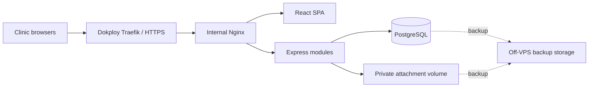

# Application architecture

Status: architectural shape, shared clinic isolation and SSE/REST approved by owner on 2026-10-10. Detailed implementation policies below are the design baseline; explicitly listed follow-ups remain open. Related: foundation issue #2 and Spec 001. This document selects implementation structure; owner product contracts for issues #3-#6 are recorded in their decision notes; outstanding evidence and real-data gates remain explicit. The owner condition for initial baseline publication is satisfied; future work uses human-reviewed pull requests.

## Shape

One npm-workspaces repository: `apps/web` (React/TypeScript/Vite), `apps/api` (Express/TypeScript), and `packages/contracts` (Zod input/output schemas and transport types). Keep deployment files in `infra/` and Prisma schema/migrations with the backend. Share transport contracts; expose neither database models nor authorization logic to the browser.

On the approved Dokploy host, Traefik terminates public HTTPS and forwards to internal Nginx. Nginx serves the compiled SPA and proxies `/api/v1` to Express on the same origin. API and PostgreSQL use a private Compose network. Only the web entry point is public. Start with one API process and one database; use separate isolated test persistence. PostgreSQL-backed sessions support later additional API processes without changing authentication storage.

For the owner's existing Contabo/Dokploy host, the owner approved an ingress adaptation on 2026-10-10: Dokploy's Traefik terminates public HTTPS and forwards to internal Nginx, which serves the SPA and proxies the API. Nginx does not bind host ports 80/443. Only Nginx joins ingress; API/PostgreSQL remain private. Validate forwarded headers, secure cookies and SSE through both proxies. See ../planning/foundation-infrastructure-assessment.md for deployment evidence and remaining gates; the diagram below includes the approved ingress hop.

## Module ownership

| Module | Owns | Representative interface behavior |
| --- | --- | --- |
| Identity and access | Accounts, sessions, permissions, assignment grants and historical access | Resolve actor; authorize action and record scope; revoke sessions |
| Patients | Identity, contact/guardian details, duplicate checks and archive state | Register patient; find accessible patients |
| Scheduling | Appointments, chairs, availability and change history | Book/reschedule with explicit override evidence |
| Clinical care | Medical history, dental chart, catalog, plan versions/acceptance, procedure progress, visits, notes and prescriptions | Accept plan; start care; finalize note; complete procedure |
| Billing | Due charges, deposits, payment allocations, receipts, invoices and adjustments | Apply funds atomically; issue eligible invoice; calculate balance |
| Inventory | Items, suppliers, packs, batches and stock movements | Receive packs; consume batch; adjust with reason |
| Files | Attachment metadata, private objects, quotas and access-controlled delivery | Upload within quota; deliver authorized attachment |
| Reporting and export | Authorized read projections and export jobs | Produce operational report or authorized clinic export |

Each module exposes a small public entry point; other modules use that interface. Keep Prisma queries and internal helpers private to the owning module. Avoid generic repositories that merely mirror Prisma methods, and add adapters only where behavior actually varies. Shared infrastructure covers database connections, request context, logging and time; it does not become a shared business-logic folder.

Cross-module business actions use explicit orchestration. Starting a procedure and recording its full agreed charge must commit together in one database transaction. Billing owns financial invariants; the caller passes the transaction context to participating internal operations. Never independently commit the clinical half and then attempt the financial half. HTTP routes authenticate, validate and call application behavior; they do not duplicate business rules.

## Clinic isolation — owner confirmed

Owner selected one shared application/database, with a clinic ID on every clinic-owned record. Derive the authorized clinic from server-verified membership; client-supplied IDs never confer access. Use clinic-scoped uniqueness and composite references to prevent cross-clinic relationships. Every query, command, file delivery and report enforces both clinic scope and the actor's permission/patient scope. Prove isolation with tests involving two clinics.

Owner approved database row-level security as an additional layer on 2026-10-10; application permissions remain mandatory. Use the restricted runtime role and transaction-local clinic context described in ../planning/foundation-version-research.md, with verification through the pinned Prisma adapter/pool before claiming isolation is proven. PostgreSQL table owners normally bypass row security, so claiming RLS without the correct runtime role would give misleading protection.

Accounts belong to one clinic for MVP. Reviewed issue #3 selects stable globally unique clinic codes plus case-insensitive clinic-unique usernames; see ../planning/identity-access-decisions.md for syntax, recovery/session lifecycle, full permission matrix and financial/historical scopes. The product supports tenant isolation without adding self-service clinic registration or a platform administrator UI.

## Consistency and history

Use PostgreSQL constraints and transactions for money allocation, document numbering, stock decrements and appointment conflict enforcement. Prisma remains the ORM; use reviewed parameterized SQL/migrations when required constraints or locking cannot be expressed through its pinned interface.

Store exact integer minor units with the currency on every monetary record. Manager-enabled currencies have separate balances/no conversion; reject excess precision without rounding. financial-decisions.md defines owner-approved numbering, allocation and correction rules; verify precision for enabled currencies. Preserve immutable financial entries and link corrections/reversals. Clinical finalized records and accepted plan versions retain dated revisions. Use record versions for draft/plan updates, returning an explicit conflict instead of silently overwriting. Consequential POST operations accept idempotency keys so a retried request cannot create a second payment, receipt or stock movement.

Keep essential audit events independent of the future paid searchable-history presentation. Historical access queries select permitted versions at the approved cutoff, rather than returning the current record with hidden fields. Identity and clinical decision notes define cutoff/revision behavior; runtime verification remains required.

## Browser state and synchronization

TanStack Query owns server records; Zustand owns shared UI state; React Hook Form owns form input; component-local hooks own private UI details. Clear patient-related cached state on logout/account or clinic change. Keep sensitive drafts/cache out of persistent browser storage. During connection loss, current-tab draft memory and explicit saving/error states follow the approved MVP behavior.

Owner selected immediate push updates at launch. Approved transport: SSE notifications plus REST writes. Send minimal authorized invalidation signals after transaction commit; fetch records through the normal authorized interface. Recheck sessions and access grants for long-lived streams, terminate revoked access, and refetch authorized state on reconnect. Nginx must stream events without response buffering, with heartbeat/timeouts and HTTP/2 verified. Refresh speed does not replace server-side concurrency checks. Build French strings behind a translation interface and use layout properties compatible with future RTL; additional languages remain deferred.

## Files, jobs and deployment

Recommended initial file adapter: private persistent VPS volume with metadata in PostgreSQL. Authorize every delivery; use opaque generated storage keys, validate content/size and enforce quota atomically. Back up files off the VPS together with a recoverable database point; same-server Docker volumes are persistence, not disaster backups. Object storage can replace the adapter when storage volume/operations justify it.

No separate queue infrastructure initially. Short operations run in request transactions. Introduce a persistent PostgreSQL job/outbox table and a worker from the same backend image when exports or future paid automation need durable asynchronous work. Schedule backups independently of application requests. AI work later uses a separate resource-limited worker through a documented interface; it does not run inside billing or clinical save transactions.

Compose defines reproducible API, database and Nginx deployment. Build immutable images, health checks, graceful API shutdown, resource/log limits and explicit migrations. Test on fictional data before live use. TLS provisioning, provider/domain/workloads, backup retention-policy approval under #6, final destination cost/capability checks and restore rehearsal remain infrastructure gates; the one-hour recovery targets are not established by this architecture.

## Verification and remaining choices

Use the already approved HTTP/application workflow tests against real isolated PostgreSQL, plus a small Playwright suite. Prioritize clinic/patient isolation, financial/stock concurrency, idempotent retries, note conflicts and historical cutoff behavior. Restore verification is a separate rehearsal.

Owner decisions complete: modular monolith, shared application/database with clinic isolation, SSE plus REST for immediate updates, RLS and session-bound CSRF baselines, and performance workload/thresholds. See the foundation research and infrastructure notes for the 2026-10-10 decisions. Technical follow-up: version-pin verification, RLS/CSRF implementation and runtime verification, performance measurements, verification of the selected Contabo S3 EU/250 GB backup baseline and conditional retention, recovery feasibility, and job thresholds. Identity/access planning review passed; its reviewed contract governs current account/patient/financial access boundaries. Financial, clinical and file owner contracts are in their respective decision notes; #6 defines financial/mixed file capability mapping. Qualified clinical/legal validation, account-specific provider/transfer/retention evidence, transactional-mail delivery and runtime verification remain gates. None is silently marked complete by accepting the architecture.

## Primary references consulted

- Docker Compose production: https://docs.docker.com/compose/how-tos/production/
- Prisma transactions (API depends on pinned major): https://www.prisma.io/docs/orm/fundamentals/transactions
- PostgreSQL row security and owner bypass: https://www.postgresql.org/docs/current/ddl-rowsecurity.html

## Alternatives considered

| Option | Main benefit | Cost in this project |
| --- | --- | --- |
| Modular monolith (recommended) | Functional locality and small interfaces; shared transactions | Modules deploy together; module ownership needs enforcement |
| Layered monolith | Familiar controller/service/repository organization | Clinical and financial changes spread across technical layers |
| Microservices | Independent deployment and scaling | More operations and distributed consistency work for connected treatment/billing flows |

SSE plus REST is selected for immediate notifications. WebSockets remain an alternative for future bidirectional streaming needs. Neither implies collaborative document editing or automatic conflict resolution.

Realtime references: https://developer.mozilla.org/en-US/docs/Web/API/Server-sent_events/Using_server-sent_events and https://nginx.org/en/docs/http/ngx_http_proxy_module.html#proxy_buffering
